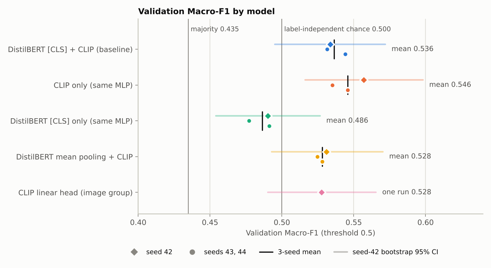
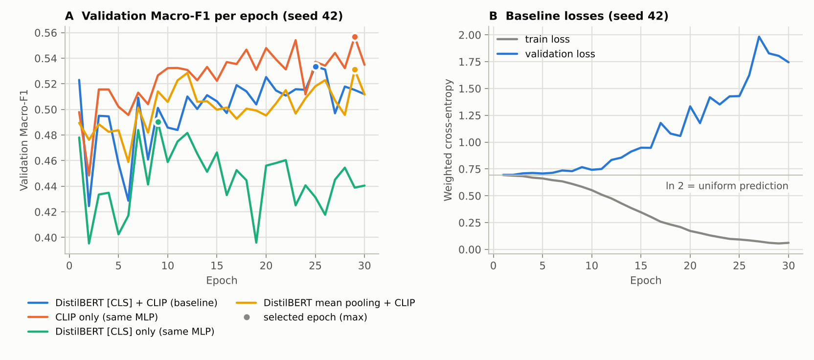
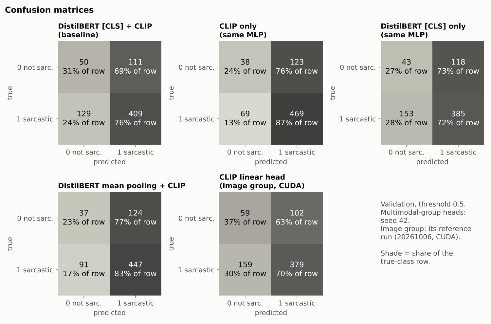
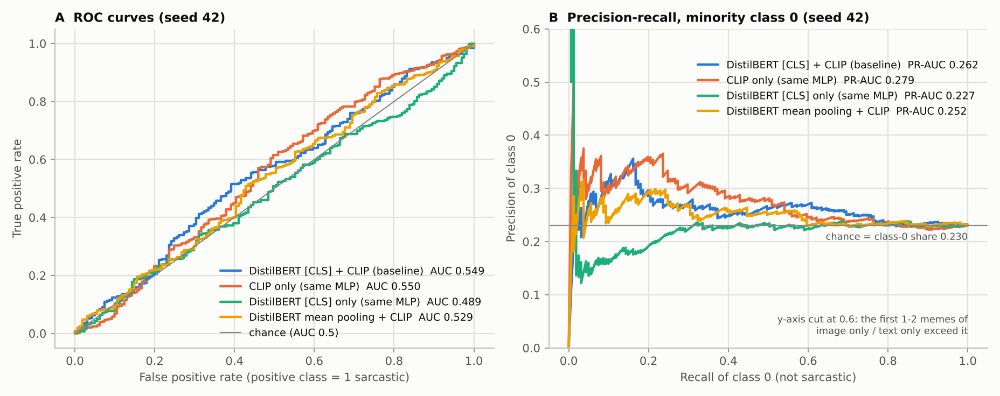
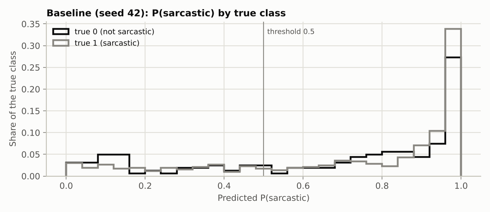
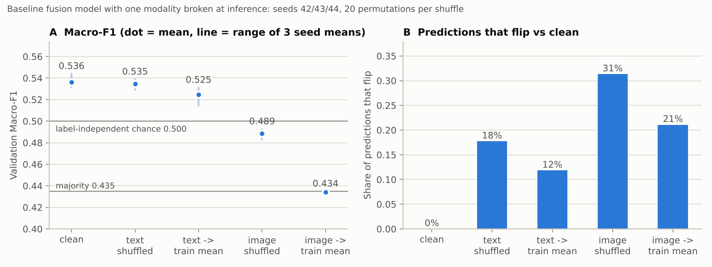
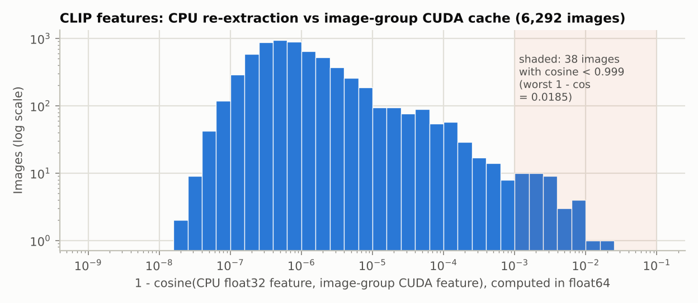

# Multimodal stage: final results report / 多模态阶段最终结果报告

Validation split only (699 memes), threshold 0.5. The epoch is chosen by validation Macro-F1 (README 5.1). No model was evaluated on Test; §3 describes only Test's label counts and caption lengths. All multimodal training and every statistic here were computed on CPU. The baseline's image features and the image-group head come from the image group's CUDA run. Numbers and figures come from `python -m src.evaluation.results_report` ([report/](report/)), except the §10 checks, which cite `scripts/check_tf32_emulation.py` ([report/tf32_emulation.json](report/tf32_emulation.json)), [docs/Multimodal_Test_Results.md](../../docs/Multimodal_Test_Results.md) and its logs. Settings: bootstrap 10,000 resamples; label permutations 10,000; caption/image shuffles 20 permutations per seed.

仅 Validation（699 张梗图），阈值 0.5，按 Validation Macro-F1 选 epoch（README 5.1）。没有任何模型在 Test 上评估；§3 只描述 Test 的标签分布和文字长度。所有多模态训练和本报告的统计都在 CPU 上完成；基线使用的图片特征和图片组分类头来自图片组的 CUDA 运行。数字与图片由 `python -m src.evaluation.results_report` 生成（[report/](report/)），§10 的检查除外：它们引用 `scripts/check_tf32_emulation.py`（[report/tf32_emulation.json](report/tf32_emulation.json)）、[docs/Multimodal_Test_Results.md](../../docs/Multimodal_Test_Results.md) 及其日志。设置：bootstrap 10,000 次重采样；标签置换 10,000 次；文字/图片打乱每个 seed 20 次。

## 1. Summary / 摘要

| | |
|---|---|
| Baseline (frozen DistilBERT [CLS] + frozen CLIP, MLP 1536-512-2), seed 42 | **Macro-F1 0.5336** (bootstrap 95% CI 0.495–0.572), accuracy 0.6567 |
| Same, 3 seeds | **0.5364 ± 0.0067** |
| References | majority (always 1) 0.4349 · **label-independent classifier ≈ 0.50** |
| Ranking quality (ROC-AUC) | 0.549 at seed 42 (95% CI 0.498–0.601); 0.540 ± 0.008 over seeds |
| Highest mean on validation (not significantly different from the baseline) | CLIP only with the same MLP, 0.5459 ± 0.0108 |

1. **Every frozen-feature model is at or barely above chance.** The always-1 majority baseline (0.435) is a degenerate floor for Macro-F1. A classifier that ignores the labels scores about 0.50. The baseline is 0.034 above that level at seed 42. Its label-permutation p-value is 0.015–0.048 across seeds, and that is optimistic, because the epoch was selected on the same validation set.
2. **Image features carry a weak signal; frozen DistilBERT text features carry none we can detect.**
   - Image only: permutation p = 0.001–0.017 (also uncorrected for epoch selection; ROC-AUC permutation p 0.03–0.17). A standardized linear probe reaches validation ROC-AUC 0.53–0.54.
   - Text only: Macro-F1 0.486, permutation p = 0.68–0.87. Linear probes on [CLS] and on mean-pooled vectors both stay at validation ROC-AUC ≤ 0.50.
3. **With this concat-MLP head, fusion shows no measurable gain over image only.** The 3-seed difference is −0.010, 95% CI [−0.037, +0.017], p = 0.49.
4. **Breaking or removing one modality at inference agrees.**
   - Shuffling captions between memes leaves Macro-F1 unchanged (0.535 vs 0.536), although 18% of predictions flip.
   - Shuffling images lowers it to 0.489, which is chance level.
   - Replacing every image feature with the training-set mean CLIP vector makes the model predict "sarcastic" for 99.8% of memes (0.434).
5. **Noise dominates small differences.** Validation sampling error (bootstrap SD ≈ 0.019) and epoch selection (+0.012 to +0.023) are both larger than the seed-to-seed spread (SD ≈ 0.007). Differences below about 0.03–0.04 Macro-F1 cannot be resolved on 699 memes.

1. **所有冻结特征模型都处于或仅略高于随机水平。** 对 Macro-F1 而言，"总是预测 1"的多数类基线（0.435）是一个退化的下限；一个完全不看标签的分类器能得到约 0.50。基线在 seed 42 下比这一水平高 0.034；各 seed 的标签置换 p 为 0.015–0.048，而且这个 p 值偏乐观，因为 epoch 是在同一份 Validation 上选出来的。
2. **图像特征有微弱信号，冻结 DistilBERT 文字特征检测不到信号。**
   - 纯图像：置换 p = 0.001–0.017（同样未校正 epoch 选择；ROC-AUC 的置换 p 为 0.03–0.17）；标准化线性探针在 Validation 上 ROC-AUC 为 0.53–0.54。
   - 纯文字：Macro-F1 0.486，置换 p = 0.68–0.87；[CLS] 和 mean pooling 向量上的线性探针在 Validation 上 ROC-AUC 都 ≤ 0.50。
3. **在这个拼接 + MLP 分类头下，融合相对纯图像没有可测量的增益**：3 个 seed 的差为 −0.010，95% CI [−0.037, +0.017]，p = 0.49。
4. **推理时破坏或去除某一模态，结论一致。**
   - 在梗图之间打乱文字，Macro-F1 不变（0.535 对 0.536），尽管 18% 的预测改变。
   - 打乱图片则降到 0.489，处于随机水平。
   - 把图片特征全部换成训练集平均 CLIP 向量后，模型对 99.8% 的梗图预测"讽刺"（0.434）。
5. **小差异被噪声淹没**：Validation 抽样误差（bootstrap 标准差 ≈ 0.019）和 epoch 选择（+0.012 至 +0.023）都大于 seed 间差异（标准差 ≈ 0.007）。在 699 张梗图上，约 0.03–0.04 以下的 Macro-F1 差异无法分辨。

## 2. Setup / 设置

- **Data.** `MMSoc_Memotion_exported` with the fixed team split. Binary sarcasm: `not_sarcastic` = 0, all other classes = 1. Text is `text_input`, which equals `text_corrected` except one train meme that falls back to `text_ocr`; empty text becomes `[NO_TEXT]`.
- **Text.** Frozen `distilbert-base-uncased` @ `1c4513b2…`, final-layer `[CLS]` vector (768-d), max 128 tokens. This is the same token position that HF `DistilBertForSequenceClassification` classifies from. Unlike that model, and unlike the paper's GLUE setup, the encoder here is not fine-tuned and there is no trained pre-classifier layer. DistilBERT was also trained without next-sentence prediction, so its frozen [CLS] is not a trained sentence embedding. Ablation: masked mean pooling.
- **Image.** Frozen CLIP ViT-B/32 @ `3d74acf`, `pooler_output` (768-d), from the image group's cache.
- **Fusion.** Each vector is L2-normalized, the two are concatenated [text | image] (1536-d), then Linear 512 → ReLU → Dropout 0.2 → Linear 2. Image only and text only use the same MLP on one 768-d input.
- **Training.** Weighted cross-entropy (w0 = 2.281, w1 = 0.640, train only), AdamW lr 1e-3, weight decay 1e-4, batch 16, 30 epochs, seeds 42/43/44.
- **Weight copies.** huggingface.co was blocked in this environment, so local copies were used. DistilBERT came from Hugging Face's legacy S3 files (weights SHA-256 `e60d7161…`). The CPU CLIP cache came from OpenAI's `ViT-B-32.pt`, whose SHA-256 matches OpenAI's URL, converted locally. Neither copy has been compared with a cache extracted from the Hub revision. For CLIP, the CPU cache agrees with the image group's Hub-based CUDA cache once TF32 is emulated (§10). For DistilBERT, that comparison is still to be run (see the README known problems).

- **数据**：`MMSoc_Memotion_exported`，团队固定划分；二分类：`not_sarcastic` = 0，其余 = 1；文字为 `text_input`，除 1 条 train 样本回退到 `text_ocr` 外与 `text_corrected` 相同；空文本 → `[NO_TEXT]`。
- **文字**：冻结 `distilbert-base-uncased` @ `1c4513b2…`，最后一层 `[CLS]` 向量（768 维），最长 128 token。这与 HF `DistilBertForSequenceClassification` 分类时用的 token 位置相同。但与该模型和论文的 GLUE 设置不同，这里编码器没有微调，也没有训练过的 pre-classifier 层；DistilBERT 训练时没有 next-sentence prediction，因此冻结的 [CLS] 并不是训练过的句向量。对照组：masked mean pooling。
- **图片**：冻结 CLIP ViT-B/32 @ `3d74acf`，`pooler_output`（768 维），来自图片组缓存。
- **融合**：分别 L2 归一化后拼接 [文字 | 图片]（1536 维），再经 Linear 512 → ReLU → Dropout 0.2 → Linear 2；纯图像、纯文字使用同一 MLP，输入为单个 768 维向量。
- **训练**：加权交叉熵（w0 = 2.281，w1 = 0.640，仅由 Train 计算），AdamW lr 1e-3，weight decay 1e-4，batch 16，30 epochs，seed 42/43/44。
- **权重副本**：本环境无法访问 huggingface.co，因此使用本地副本。DistilBERT 来自 Hugging Face 旧版 S3 文件（权重 SHA-256 `e60d7161…`）；CPU CLIP 缓存来自 OpenAI 的 `ViT-B-32.pt`（SHA-256 与 OpenAI 官方 URL 一致），在本地转换。两份副本都还没有与从 Hub revision 提取的缓存对比过。对 CLIP 而言，模拟 TF32 后 CPU 缓存与图片组基于 Hub 的 CUDA 缓存一致（§10）；对 DistilBERT 而言，这一对比仍待完成（见 README 已知问题）。

## 3. Dataset statistics / 数据统计

| Split | n | class 0 | class 1 | share sarcastic | general / twisted / very twisted | `[NO_TEXT]` | tokens mean / median / max | > 128 tokens |
|---|---:|---:|---:|---:|---|---:|---|---:|
| train | 5,593 | 1,226 | 4,367 | 78.1% | 2,797 / 1,262 / 308 | 1 | 23.0 / 20 / 261 | 4 |
| validation | 699 | 161 | 538 | 77.0% | 367 / 134 / 37 | 0 | 23.0 / 21 / 96 | 0 |
| test | 700 | 157 | 543 | 77.6% | 343 / 151 / 49 | 3 | 23.2 / 20 / 135 | 1 |

Only 161 validation memes are class 0. That makes class-0 F1 the hard part of Macro-F1, and its bootstrap CI is wide (baseline 0.229–0.356).

Validation 中只有 161 张属于 class 0，因此 class 0 的 F1 是 Macro-F1 的难点，其 bootstrap CI 也很宽（基线 0.229–0.356）。

## 4. Metrics / 指标

Seed 42 (the README milestone run) plus references.

- "Chance" is the expected Macro-F1 of a label-independent classifier that predicts class 1 as often as the model does. It is 0.50 when the model predicts class 1 at the 77% base rate.
- ROC-AUC and PR-AUC are threshold-free. PR-AUC(0) treats the minority class as positive; its chance level is 0.230.
- ECE uses 10 equal-width bins on P(sarcastic).

seed 42（README 里程碑实验）与参考模型：
- "Chance"是一个不看标签、且预测 class 1 频率与该模型相同的分类器的期望 Macro-F1；当预测 class 1 的比例等于 77% 的基础比例时为 0.50。
- ROC-AUC、PR-AUC 与阈值无关；PR-AUC(0) 以少数类为正类，随机水平为 0.230。
- ECE 对 P(讽刺) 使用 10 个等宽分箱。

| Model | Macro-F1 | chance | Accuracy | Bal. acc. | F1 0 | F1 1 | ROC-AUC | PR-AUC (0) | Brier | ECE | predicted 1 |
|---|---:|---:|---:|---:|---:|---:|---:|---:|---:|---:|---:|
| Majority (always 1) | 0.4349 | 0.435 | 0.7697 | 0.5000 | 0.0000 | 0.8698 | 0.5000 | 0.2303 | 0.2303 | 0.2303 | 100% |
| CLIP linear head (image group, CUDA) | 0.5276 | 0.496 | 0.6266 | 0.5355 | 0.3113 | 0.7439 | 0.5411 | 0.2561 | 0.2287 | 0.1930 | 68.8% |
| **DistilBERT [CLS] + CLIP (baseline)** | **0.5336** | 0.500 | 0.6567 | 0.5354 | 0.2941 | 0.7732 | 0.5493 | 0.2624 | 0.2607 | 0.2402 | 74.4% |
| CLIP only, same MLP | 0.5568 | 0.495 | 0.7253 | 0.5539 | 0.2836 | 0.8301 | 0.5502 | 0.2787 | 0.2424 | 0.2240 | 84.7% |
| DistilBERT [CLS] only, same MLP | 0.4903 | 0.498 | 0.6123 | 0.4913 | 0.2409 | 0.7397 | 0.4887 | 0.2268 | 0.2395 | 0.2406 | 72.0% |
| DistilBERT mean pooling + CLIP | 0.5311 | 0.498 | 0.6924 | 0.5303 | 0.2561 | 0.8061 | 0.5291 | 0.2519 | 0.2553 | 0.2395 | 81.7% |
| Baseline rerun on CPU image features | 0.5435 | 0.497 | 0.7067 | 0.5418 | 0.2705 | 0.8165 | 0.5305 | 0.2570 | 0.2462 | 0.2283 | 82.8% |

Accuracy tracks how often a model predicts class 1. The majority baseline has the highest accuracy (0.770), which is why Macro-F1 is the primary metric.

准确率主要反映模型预测 class 1 的频率：多数类基线的准确率最高（0.770），这正是以 Macro-F1 为主要指标的原因。

Calibration is poor. Brier is 0.23–0.26 and ECE about 0.2. A constant prediction at the base rate (P = 0.770) would score Brier 0.177 and ECE 0, so every model is worse than that constant. The direction of the miscalibration differs by model:
- Class weighting pulls the mean P(sarcastic) below the 0.770 base rate for the baseline (0.72–0.78), text only (0.53–0.54) and the image group's linear head (0.58).
- Image only (0.77–0.83) and mean pooling (0.77–0.79) are at or above the base rate.
- The image-based MLPs put 35–69% of their probabilities above 0.9 ([metrics_by_run.csv](report/metrics_by_run.csv); Figure 5 shows the baseline at seed 42, 44%). Text only and the linear head are miscalibrated without extreme probabilities: 0% and 0.3% of their probabilities are above 0.9.

校准较差：Brier 0.23–0.26，ECE 约 0.2。按基础比例的常数预测（P = 0.770）Brier 为 0.177、ECE 为 0，所有模型都不如这个常数。不同模型的偏差方向不同：
- 类别加权使基线（0.72–0.78）、纯文字（0.53–0.54）和图片组线性头（0.58）的平均 P(讽刺) 低于 0.770 的基础比例。
- 纯图像（0.77–0.83）与 mean pooling（0.77–0.79）则等于或高于基础比例。
- 使用图像的 MLP 有 35–69% 的概率高于 0.9（[metrics_by_run.csv](report/metrics_by_run.csv)；图 5 显示的是 seed 42 的基线，为 44%）。纯文字和线性头没有极端概率（高于 0.9 的比例为 0% 和 0.3%），但同样校准不佳。

## 5. Chance, seeds and uncertainty / 随机水平、多 seed 与不确定性

| Model | Macro-F1 mean ± std (min–max) | seed-42 bootstrap 95% CI | label-permutation p, seeds 42 / 43 / 44 | seed-42 ROC-AUC [95% CI] | best epoch |
|---|---|---|---|---|---|
| DistilBERT [CLS] + CLIP | 0.5364 ± 0.0067 (0.5315–0.5441) | 0.495–0.572 | 0.048 / 0.044 / 0.015 | 0.549 [0.498, 0.601] | 25, 27, 21 |
| CLIP only | 0.5459 ± 0.0108 (0.5352–0.5568) | 0.516–0.598 | 0.001 / 0.017 / 0.010 | 0.550 [0.497, 0.603] | 29, 23, 19 |
| DistilBERT [CLS] only | 0.4862 ± 0.0079 (0.4771–0.4912) | 0.454–0.527 | 0.70 / 0.87 / 0.68 | 0.489 [0.439, 0.537] | 9, 12, 11 |
| mean pooling + CLIP | 0.5280 ± 0.0032 (0.5247–0.5311) | 0.493–0.570 | 0.053 / 0.112 / 0.071 | 0.529 [0.478, 0.581] | 29, 28, 23 |
| CLIP linear (image group) | 0.5276 (one run) | 0.490–0.566 | 0.053 | 0.541 [0.491, 0.592] | 7 |

How the permutation test works: the labels are permuted 10,000 times while each model's predictions stay fixed. The null mean is 0.493–0.500 and its 95th percentile is 0.525–0.533. **These p-values do not account for picking the best of 30 epochs on the same validation set**, so the true evidence is weaker. The bootstrap SD of Macro-F1 (≈ 0.019) is about three times the seed SD (≈ 0.007).

置换检验：保持各模型预测不变，把标签置换 10,000 次；零分布均值为 0.493–0.500，95 分位为 0.525–0.533。**这些 p 值没有考虑在同一份 Validation 上从 30 个 epoch 中挑最好的一个**，真实证据更弱。Macro-F1 的 bootstrap 标准差（≈ 0.019）约为 seed 标准差（≈ 0.007）的 3 倍。

## 6. Paired comparisons with the baseline / 与基线的配对比较

Δ = baseline minus the other model, on the same 699 memes. The "seed mean" column compares 3-seed averages under the same bootstrap resamples. It holds the trained heads fixed, so training-seed variance is not included. McNemar tests **accuracy** on the discordant pairs, not Macro-F1. The bootstrap p is two-sided; with 10,000 resamples it cannot go below 2e-4.

Δ = 基线减另一模型，在同一 699 张梗图上计算。"seed 均值"在相同 bootstrap 重采样下比较 3 个 seed 的平均，训练好的分类头固定不变，因此不含训练 seed 方差。McNemar 检验的是不一致样本上的**准确率**，不是 Macro-F1。bootstrap p 为双侧，10,000 次重采样下最小只能到 2e-4。

| Baseline vs | Δ Macro-F1, seed 42 [95% CI], p | Δ Macro-F1, seed mean [95% CI], p | McNemar (seed 42): only baseline right / only other right, p |
|---|---|---|---|
| CLIP only | −0.023 [−0.064, +0.018], p = 0.27 | −0.010 [−0.037, +0.017], p = 0.49 | 40 / 88, p = 2.7e-5 |
| DistilBERT [CLS] only | +0.043 [−0.005, +0.091], p = 0.074 | +0.050 [+0.009, +0.092], p = 0.017 | 132 / 101, p = 0.049 |
| mean pooling + CLIP | +0.003 [−0.035, +0.040], p = 0.90 | +0.008 [−0.016, +0.033], p = 0.49 | 47 / 72, p = 0.027 |
| CLIP linear (image group) | +0.006 [−0.034, +0.045], p = 0.77 | — | 84 / 63, p = 0.099 |
| Majority | +0.099 [+0.058, +0.139], p < 2e-4 | — | 50 / 129, p = 3.1e-9 |

- **The only robust difference is against the degenerate majority baseline.** The text-only seed-mean gap (+0.050, p = 0.017) is nominally significant without correction. It fails a Bonferroni or Holm correction over the five comparisons (α = 0.01 / 0.0125), and the seed-42 test is not significant (p = 0.074).
- **The McNemar gap against CLIP only is about accuracy.** Image only predicts class 1 more often (84.7% vs 74.4%); 77 of the 88 memes that only image-only gets right are class 1. That raises accuracy but is not a Macro-F1 difference.
- **Prediction overlap at seed 42.** The baseline agrees with image only on 81.7% of labels (probability correlation r = 0.63) and with text only on 66.7% (r = 0.29). Image only and text only agree on 68.4% (r = 0.15).

- **唯一稳健的差异是相对退化的多数类基线**。相对纯文字的 seed 均值差（+0.050，p = 0.017）在不校正时名义上显著，但在 5 组比较的 Bonferroni/Holm 校正下不显著（α = 0.01 / 0.0125），seed 42 的检验也不显著（p = 0.074）。
- **相对纯图像的 McNemar 差异反映的是准确率**：纯图像更常预测 class 1（84.7% 对 74.4%），只有纯图像判对的 88 个样本中有 77 个是 class 1。这提高了准确率，但不是 Macro-F1 差异。
- **seed 42 的预测重合度**：基线与纯图像标签一致 81.7%（概率相关 r = 0.63），与纯文字 66.7%（r = 0.29）；纯图像与纯文字 68.4%（r = 0.15）。

## 7. Training dynamics / 训练过程

- **Overfitting: what is observed, what is tested** (full diagnostic: [overfitting/README.md](overfitting/README.md)).
  - *Observed.* Scored with the same parameters, one loss definition and `eval()` mode on both splits, the selected fusion heads reach train Macro-F1 0.978–0.995 and train ROC-AUC ≥ 0.999, against validation 0.53–0.54 and 0.53–0.55. Image-only heads do the same. The heads memorize the training set.
  - *Observed.* Validation loss is lowest at epoch 1 in every fusion and image-only run (≈ ln 2 = 0.693, a uniform prediction) and rises to 1.16–1.64 (fusion) at the selected epoch. The rise comes from over-confident errors (seed 42: 0 → 92 errors at ≥ 90 % confidence by epoch 25, of 240 errors), not from worse ranking: validation ROC-AUC stays at 0.52–0.55 and Macro-F1 peaks late (epochs 19–29). Validation loss therefore cannot guide epoch selection here, but "training longer classifies worse" is not what the curves show.
  - *Accounting.* The logged train loss (dropout on, batch means while weights move) is not on the same footing as the logged validation loss (whole split, `eval()`): at epoch 25 it is 0.092 against 0.058 in `eval()` mode.
  - *Tested.* Smaller or linear heads, dropout 0.5, weight decay 1e-2 and a 10× lower learning rate reduce the train−validation gap (ROC-AUC gap 0.46 → 0.20 for a linear head) but do not raise validation Macro-F1 or ROC-AUC, and fusion stays below image only in all 8 head variants (fusion higher in 1 of 24 seed pairs). Overfitting is real, but the sweep does not support it as the main reason fusion shows no gain.
- **Text only barely fits even the training data.** Its train loss is still 0.61 at epoch 30.
  - **Description only, not a cause:** L2-normalized frozen [CLS] vectors share a dominant mean direction. The exact mean pairwise cosine is 0.897 (norm of the mean vector 0.947), against 0.268 for CLIP image vectors ([feature_geometry.csv](report/feature_geometry.csv)).
  - **The shared direction is not why validation fails.** Standardizing the features removes it, and a logistic-regression probe then fits the training set (ROC-AUC 0.67–0.76), yet validation ROC-AUC stays at 0.47–0.50. Mean pooling (cosine 0.726) does no better (0.46–0.47).
  - The image probe reaches validation ROC-AUC 0.53–0.54. Text + image reaches 0.52–0.53, below image alone ([linear_probes.csv](report/linear_probes.csv)).
- **Selection optimism.** The chosen epoch is the maximum of a noisy curve. For the baseline, validation Macro-F1 changes by 0.016–0.022 between consecutive epochs on average, and by up to 0.099.
  - The selected value exceeds the mean of the last 10 epochs by 0.0175 ± 0.0059 (baseline; range 0.012–0.023 over seeds), 0.0140 ± 0.0048 (image only) and 0.0169 ± 0.0027 (mean pooling).
  - For text only the gap is 0.0464 ± 0.0060. Its best epochs are 9–12, and its curve declines afterwards, so that gap mixes real early-stopping effect with selection noise.
  - Treat single-run validation numbers of the image-based models as optimistic by about 0.015–0.02.

- **过拟合：观察到的与检验过的**（完整诊断见 [overfitting/README.md](overfitting/README.md)）：
  - *观察到*：用同一组参数、同一 loss 定义、`eval()` 模式同时评估两个划分，所选融合分类头的训练 Macro-F1 为 0.978–0.995、训练 ROC-AUC ≥ 0.999，而验证集为 0.53–0.54 和 0.53–0.55；纯图像分类头相同。分类头记住了训练集。
  - *观察到*：所有融合与纯图像实验的验证 loss 都在第 1 个 epoch 最低（≈ ln 2 = 0.693，即均匀预测），在所选 epoch 升到 1.16–1.64（融合）。上升来自高置信错误（seed 42：到第 25 个 epoch，240 个错误中有 92 个置信度 ≥ 90%，第 1 个 epoch 为 0），而不是排序变差：验证 ROC-AUC 保持在 0.52–0.55，Macro-F1 在后期（第 19–29 个 epoch）达到最高。因此验证 loss 不能用来选 epoch，但曲线并不表明"训练越久分类越差"。
  - *口径*：记录的 train loss（开启 dropout、参数在 epoch 内变化、对小批次求平均）与记录的 validation loss（整个划分、`eval()`）口径不同；第 25 个 epoch 时前者为 0.092，`eval()` 口径为 0.058。
  - *检验过*：更小的或线性分类头、dropout 0.5、weight decay 1e-2、学习率降为 1/10 都能缩小训练-验证差距（线性头 ROC-AUC 差距 0.46 → 0.20），但没有提高验证 Macro-F1 或 ROC-AUC；8 种分类头下融合都低于纯图像（24 对 seed 中只有 1 对融合更高）。过拟合确实存在，但扫描结果不支持它是融合没有提升的主要原因。
- **纯文字连训练集都几乎拟合不了**：第 30 个 epoch 时 train loss 仍为 0.61。
  - **以下只是描述，不是原因**：L2 归一化后的冻结 [CLS] 向量共享一个主导的平均方向，精确的两两平均余弦为 0.897（平均向量范数 0.947），CLIP 图像向量为 0.268（[feature_geometry.csv](report/feature_geometry.csv)）。
  - **这个共同方向并不是 Validation 失败的原因**：特征标准化可以去掉它，之后逻辑回归探针能拟合训练集（ROC-AUC 0.67–0.76），但 Validation ROC-AUC 仍为 0.47–0.50；mean pooling（余弦 0.726）也没有更好（0.46–0.47）。
  - 图像探针的 Validation ROC-AUC 为 0.53–0.54，文字 + 图像为 0.52–0.53，低于单用图像（[linear_probes.csv](report/linear_probes.csv)）。
- **选择偏乐观**：所选 epoch 是噪声曲线的最大值；基线的 Validation Macro-F1 在相邻 epoch 间平均变化 0.016–0.022，最大 0.099。
  - 所选值比最后 10 个 epoch 的均值高：基线 0.0175 ± 0.0059（各 seed 范围 0.012–0.023），纯图像 0.0140 ± 0.0048，mean pooling 0.0169 ± 0.0027。
  - 纯文字为 0.0464 ± 0.0060，但它的最佳 epoch 在 9–12，之后曲线下降，所以这个差值混合了真实的早停效应和选择噪声。
  - 使用图像的模型，单次实验的 Validation 数字应视为偏乐观约 0.015–0.02。

## 8. Error structure / 错误结构

At seed 42 the baseline finds 50 of 161 non-sarcastic memes (recall 0.31) and 409 of 538 sarcastic ones (recall 0.76). The image-based models trade recall between the two classes along almost the same line. Image only recovers fewer class-0 memes (24%) and more class-1 memes (87%); the image group's linear head sits at the other end (37% / 70%). Text only is lower on both classes (27% / 72%).

seed 42 下，基线找出 161 张非讽刺梗图中的 50 张（召回 0.31）和 538 张讽刺梗图中的 409 张（召回 0.76）。使用图像的模型几乎沿同一条线在两类召回之间取舍：纯图像找回的 class 0 更少（24%）、class 1 更多（87%）；图片组线性头在另一端（37% / 70%）；纯文字在两类上都更低（27% / 72%）。

The ROC curves hug the diagonal: AUC 0.53–0.55 for the models that use images, 0.49 for text only. Beyond the first few memes (recall > 0.02), class-0 precision peaks at about 0.36 (baseline) and 0.375 (image only), against a prior of 0.230. The baseline stays near 0.25–0.27 up to recall ≈ 0.7 and reaches the prior around 0.8; image only gets there by ≈ 0.6. The threshold stays fixed at 0.5 (README 5.1). A diagnostic sweep over all thresholds on validation, not used for selection, raises Macro-F1 by at most 0.011 per run and leaves the ranking unchanged.

ROC 曲线紧贴对角线：使用图像的模型 AUC 为 0.53–0.55，纯文字 0.49。去掉最前面几张梗图后（召回 > 0.02），class 0 的精确率最高约 0.36（基线）和 0.375（纯图像），先验为 0.230；基线在召回约 0.7 之前保持在 0.25–0.27，约 0.8 时回到先验，纯图像在约 0.6 时回到先验。阈值按 README 5.1 固定为 0.5；在 Validation 上扫描所有阈值（仅作诊断，不用于选择），每个实验的 Macro-F1 最多提高 0.011，排序不变。

For the baseline, predicted probabilities pile up near 1 for both true classes. That overlap is the visual form of AUC ≈ 0.55.

基线对两类样本的预测概率都堆积在 1 附近；这种重叠就是 AUC ≈ 0.55 在图上的表现。

## 9. Which modality does the fusion model use? / 融合模型依赖哪种模态？

At inference, the cached text or image features of the 699 validation memes were treated in two ways, with no retraining (trained baseline heads, seeds 42/43/44):
- **Shuffled** across memes, which keeps the feature distribution but breaks the caption-image pairing.
- **Replaced** by the training-set mean vector, which removes the information.

推理时，对 699 张 Validation 梗图的文字或图片缓存特征做两种处理，不重新训练（使用已训练的基线分类头，seed 42/43/44）：
- **打乱**：在样本间打乱，保留特征分布，破坏文字与图片的配对。
- **替换**：换成训练集平均向量，去除信息。

| Condition | Macro-F1 mean (range of the 3 seed means) | predictions flipped | mean \|Δ P(sarcastic)\| | predicted 1 |
|---|---|---:|---:|---:|
| clean | 0.5364 (0.5315–0.5441) | 0% | 0 | 78.9% |
| text shuffled | 0.5347 (0.5289–0.5388) | 17.7% | 0.162 | 77.4% |
| text → train mean | 0.5245 (0.5142–0.5312) | 11.8% | 0.116 | 86.6% |
| image shuffled | 0.4887 (0.4830–0.4927) | 31.3% | 0.283 | 77.3% |
| image → train mean | 0.4343 (0.4340–0.4349) | 21.1% | 0.228 | 99.8% |

Single permutations spread further: 0.508–0.569 with text shuffled and 0.445–0.534 with images shuffled.

The head does read the text: about one prediction in six flips when captions are swapped. Swapping captions nonetheless leaves Macro-F1 where it was (−0.002). Swapping images costs 0.048 and brings the model down to the 0.50 chance level. Removing image information collapses it to "always sarcastic". For this frozen-feature baseline, the measurable signal comes from the image features, and the text input carries no detectable signal. Whether the text input actually hurts cannot be resolved, given Δ vs image only of −0.010 [−0.037, +0.017].

分类头确实读取了文字：交换文字后约六分之一的预测改变，但 Macro-F1 不变（−0.002）；交换图片则下降 0.048，降到 0.50 的随机水平；去掉图片信息后，模型退化为"总是讽刺"。对这个冻结特征基线而言，可测量的信号来自图片特征，文字输入没有可检测的信号；至于文字是否有害，鉴于相对纯图像的差为 −0.010 [−0.037, +0.017]，目前无法判断。

## 10. Reproducibility / 可复现性

- **Reload and rerun.** Checkpoint reload and same-input reruns are bit-identical.
- **Rerun on CPU image features.** This is a same-agent rerun, not the teammate reproduction the README requires.
  - The text cache was re-extracted and is bit-identical to the original. The only changed input is the image features: CPU float32 instead of the image group's CUDA cache, mean cosine 0.99997.
  - That tiny change alters 11.3% of the predicted labels and moves the selected epoch from 25 to 29.
  - Macro-F1 goes from 0.5336 to 0.5435 (Δ 0.0098, inside the 0.01 tolerance). The paired bootstrap SD of that difference is 0.015 (p = 0.51). The gap reflects training and selection sensitivity, not a real difference.
- **End-to-end checks.**
  - Raw-caption + raw-image inference through `MultimodalClassifier` matches the cached path to 6.4e-7 for the head trained on CPU caches.
  - For the main run's head, trained on the CUDA image cache, the same check agrees on all 64 labels. It fails the 0.01 probability tolerance (0.0131), because `validation_000550` is a TF32 outlier.
- **CPU vs CUDA image features.** They differ because PyTorch uses TF32 for CUDA convolutions by default.
  - 38 of 6,292 images have cosine below 0.999, and the worst has 1 − cos = 0.0185.
  - Emulating TF32 in the patch embedding ([scripts/check_tf32_emulation.py](../../scripts/check_tf32_emulation.py), [tf32_emulation.json](report/tf32_emulation.json)) cuts the mean absolute difference on the first 64 validation images from 1.7e-3 to 2.9e-5. It brings the 10 worst train and 10 worst validation images from cosine 0.981–0.985 to ≥ 0.99999995.
  - The image group's head scores 0.5286 on CPU features, against 0.5276 reported.

- **重载与重跑**：checkpoint 重载与相同输入重跑完全一致。
- **CPU 图片特征重跑**：这是同一 agent 的重跑，不是 README 要求的组员复现。
  - 文字缓存重新提取后与原缓存逐位相同；唯一变化的输入是图片特征（CPU float32 代替图片组 CUDA 缓存，平均余弦 0.99997）。
  - 这个极小的变化改变了 11.3% 的预测标签，并把所选 epoch 从 25 变为 29。
  - Macro-F1 从 0.5336 变为 0.5435（Δ 0.0098，在 0.01 容差内）；该差值的配对 bootstrap 标准差为 0.015（p = 0.51）。这个差距反映训练与选择的敏感性，不是真实差异。
- **端到端检查**：
  - 对在 CPU 缓存上训练的分类头，原始文字 + 原始图片经 `MultimodalClassifier` 推理，与缓存路径相差 6.4e-7。
  - 对主实验在 CUDA 图片缓存上训练的分类头，同一检查 64 个标签全部一致，但概率差 0.0131，超过 0.01 容差（`validation_000550` 是 TF32 离群样本）。
- **CPU 与 CUDA 图片特征**：差异来自 PyTorch 在 CUDA 卷积上默认启用的 TF32。
  - 6,292 张图片中有 38 张余弦低于 0.999，最差的 1 − cos = 0.0185。
  - 在 patch embedding 中模拟 TF32（[scripts/check_tf32_emulation.py](../../scripts/check_tf32_emulation.py)，[tf32_emulation.json](report/tf32_emulation.json)）后，前 64 张 validation 图片的平均绝对差从 1.7e-3 降到 2.9e-5；train 与 validation 各自最差的 10 张图片，余弦从 0.981–0.985 提高到 ≥ 0.99999995。
  - 图片组分类头在 CPU 特征上得到 0.5286，原报告为 0.5276。

## 11. Conclusions / 结论

1. **The first-stage multimodal pipeline is implemented.** It is aligned by `sample_id`, reproducible on one machine and documented. With the image group's cache it runs end to end on CPU in minutes. The milestone still needs two items: the teammate's second-member reproduction, and confirmation of the 16-sample manual review.
2. **On Memotion sarcasm, frozen DistilBERT + CLIP features with a concat-MLP head are at or just above chance.** Validation Macro-F1 is 0.536 ± 0.007 against ≈ 0.50 for a label-independent classifier. Only the image features carry weak signal (ROC-AUC ≈ 0.54).
3. **Fusion shows no measurable gain over image only in this setup** (Δ −0.010 [−0.037, +0.017]). Frozen DistilBERT text features carry no detectable signal: text-only permutation p = 0.68–0.87, and linear probes on [CLS] and on mean-pooled vectors stay at AUC ≤ 0.50. Whether another text encoder or fusion method would help was not tested.
4. **The evaluation is noise-limited.** Compare models by 3-seed means with paired bootstrap and label-permutation tests, not by one run's best epoch. Differences below about 0.03–0.04 cannot be resolved on 699 validation memes.
5. **Recommended next steps** (post-Oct 14, still validation-only):
   - Give the text side a chance to carry signal: fine-tune at least the last DistilBERT layers, or try another text representation. CLIP's text encoder is an untested option.
   - Lower capacity and stronger regularization were tried (§7, [overfitting/](overfitting/README.md)): they shrink the train−validation gap but do not raise validation scores or let fusion beat image only, so they are not a fix on their own. Validation loss is uninformative for selection (minimum at epoch 1, ≈ ln 2); a pre-registered fixed epoch budget or a smoothed Macro-F1 criterion would reduce selection optimism, recorded as a team decision if it replaces D10.
   - Report label-permutation p and the 3-seed mean for every model.
   - Repeat the shuffle and mean-replacement diagnostic on each new model and add OCR-noise perturbations.
   - Look at label noise: 4 of 16 reviewed labels are debatable.
   - Score Test once, at the end.

1. **第一阶段多模态流程已实现**：按 `sample_id` 对齐、在同一台机器上可复现、有文档；使用图片组缓存时，在 CPU 上几分钟即可端到端运行。里程碑仍差两项：组员的第二名成员复现，以及 16 个样本人工核对的确认。
2. **在 Memotion 讽刺任务上，冻结的 DistilBERT + CLIP 特征加拼接 + MLP 分类头处于或仅略高于随机水平**：Validation Macro-F1 为 0.536 ± 0.007，而不看标签的分类器约为 0.50；只有图像特征有微弱信号（ROC-AUC ≈ 0.54）。
3. **在此设置下，融合相对纯图像没有可测量的增益**（Δ −0.010 [−0.037, +0.017]）。冻结 DistilBERT 文字特征没有可检测的信号：纯文字置换 p = 0.68–0.87，[CLS] 和 mean pooling 向量上的线性探针 AUC 都 ≤ 0.50。其他文字编码器或融合方法是否有帮助尚未测试。
4. **评估受噪声限制**：比较模型请用 3 个 seed 的均值，并配合配对 bootstrap 和标签置换检验，而不是单次实验的最佳 epoch；699 张 Validation 梗图无法分辨约 0.03–0.04 以下的差异。
5. **建议的下一步**（10月14日之后，仍只用 Validation）：
   - 让文字端有机会带来信号：至少微调 DistilBERT 的最后几层，或尝试其他文字表示（CLIP 文字编码器是尚未测试的选项）。
   - 已尝试更小容量和更强正则（§7，[overfitting/](overfitting/README.md)）：它们能缩小训练-验证差距，但不能提高验证分数，也不能让融合超过纯图像，因此单靠它们不能解决问题。validation loss 不适合用于选择（最低点在第 1 个 epoch，≈ ln 2）；预先确定的固定 epoch 数或平滑后的 Macro-F1 准则可减少选择偏乐观，若替代 D10，需记录为团队决定。
   - 每个模型都报告标签置换 p 和 3 个 seed 均值。
   - 对每个新模型重复打乱/均值替换诊断，并加入 OCR 噪声扰动。
   - 检查标签噪声：人工核对的 16 个标签中有 4 个存疑。
   - 最后只对 Test 评分一次。

## 12. Limitations / 局限

- **Single split.** Everything uses one 699-sample validation split; by design there are no test results.
- **Bootstrap scope.** The bootstrap treats validation memes as i.i.d. It includes neither epoch-selection uncertainty (§7) nor training-seed variance (the seed-mean comparison holds the three heads fixed).
- **Permutation tests.** The p-values are uncorrected for multiple models and for epoch selection on the same data.
- **Diagnostics.** The shuffle and mean-replacement diagnostics and the linear probes use cached features. They show what these models and features contain, not what the data could support with other encoders.
- **Manual review.** The 16-sample manual review is a first pass and needs a teammate's confirmation.

- **单一划分**：全部基于一个 699 样本的 Validation，按设计没有 Test 结果。
- **Bootstrap 范围**：bootstrap 把 Validation 梗图视为独立同分布，不包含 epoch 选择的不确定性（§7），也不包含训练 seed 方差（seed 均值比较固定了 3 个分类头）。
- **置换检验**：p 值没有针对多个模型和在同一数据上选择 epoch 做校正。
- **诊断**：打乱/均值替换诊断与线性探针使用缓存特征，只说明这些模型和特征包含什么，不说明换用其他编码器时数据能支持什么。
- **人工核对**：16 个样本的人工核对是初步结果，需要组员确认。

## Files / 文件

| File | Content |
|---|---|
| [report/metrics_by_run.csv](report/metrics_by_run.csv) | every run: Macro-F1, chance level, accuracy, balanced accuracy, per-class P/R/F1, ROC-AUC, PR-AUC, Brier, ECE, probability extremes, selection statistics |
| [report/seed_summary.csv](report/seed_summary.csv) | mean / std / min / max over seeds |
| [report/chance_tests.csv](report/chance_tests.csv) | label-permutation tests (Macro-F1, ROC-AUC), ROC-AUC bootstrap CIs |
| [report/bootstrap_ci.csv](report/bootstrap_ci.csv), [report/paired_comparisons.csv](report/paired_comparisons.csv) | uncertainty and paired tests |
| [report/modality_reliance.csv](report/modality_reliance.csv) | all 129 shuffle / mean-replacement evaluations |
| [report/linear_probes.csv](report/linear_probes.csv), [report/feature_geometry.csv](report/feature_geometry.csv), [report/tf32_emulation.json](report/tf32_emulation.json) | standardized probes, exact feature anisotropy, TF32 emulation check |
| [report/dataset_stats.csv](report/dataset_stats.csv), [report/feature_agreement.json](report/feature_agreement.json) | data; CPU vs CUDA features |
| [report/stats_summary.json](report/stats_summary.json) | everything above, plus reproduction and end-to-end check details |
| [overfitting/](overfitting/README.md) | same-parameter train/validation scoring per epoch for the recorded runs, and the head capacity / regularization sweep (`python -m src.evaluation.overfitting_diagnostic`) |
| `src/evaluation/results_report.py` | regenerates all of it (about 1–2 min on CPU; needs the caches and checkpoints listed in [docs/Multimodal_Assets.md](../../docs/Multimodal_Assets.md)) |
