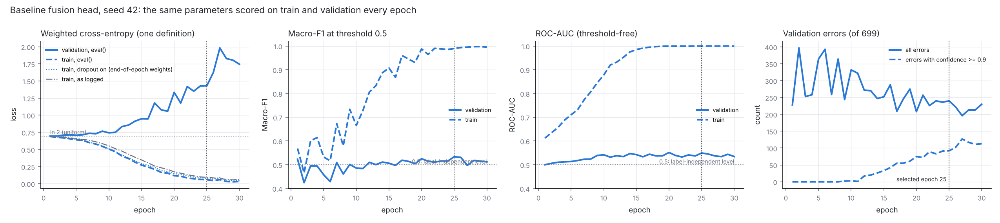
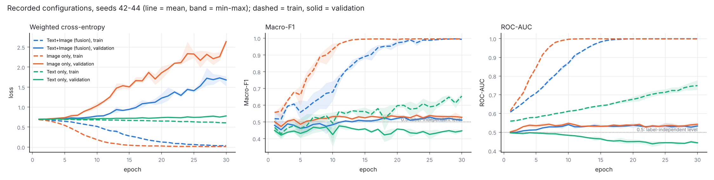
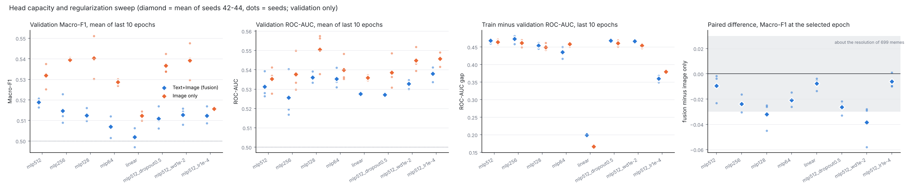

# Overfitting diagnostic / 过拟合诊断 (validation only)

Question: the fusion head fits the training set ever better while validation loss rises. Is that
overfitting, and is it why text + image does not beat image alone? This folder separates what was
**observed**, what was **tested**, and what is still **inference**. Test was not read.

问题：融合分类头越来越好地拟合训练集，而验证 loss 上升。这是否是过拟合？它是否是"文字 + 图像不优于纯图像"的原因？本文件把**观察到的**、**检验过的**和**仍属推断的**分开写。未读取 Test。

```
python -m src.evaluation.overfitting_diagnostic     # ~30 min on 4 CPUs; writes this folder
python -m src.evaluation.overfitting_diagnostic --report_only   # redraw tables and figures
```

## Method / 方法

* **Same parameters, same definition, both splits.** At the end of every epoch the head is put in
  `eval()` mode and scored on the whole train split and the whole validation split with one loss
  definition: PyTorch weighted cross-entropy, `sum_i w(y_i) * l_i / sum_i w(y_i)`, train-only class
  weights (w0 2.281, w1 0.640). Also recorded: unweighted NLL, Macro-F1 at 0.5, ROC-AUC,
  PR-AUC (class 0), ECE (10 bins), mean confidence, errors and errors made with confidence ≥ 0.9.
* **The three train-loss numbers are kept apart:** the logged training loss (dropout on, batch means
  averaged by batch size while the weights move), the full-train loss with dropout on at the
  end-of-epoch weights, and the full-train loss in `eval()` mode.
* **Reruns are exact.** The 9 recorded runs (fusion, image only, text only × seeds 42, 43, 44) were
  retrained with this scoring hooked in. Every `training_log.csv` is byte-identical and every
  selected `best.pt` bit-identical to the recorded one ([reproduction_check.csv](reproduction_check.csv)),
  so the scoring did not change training and the numbers describe the shipped heads.
* **Sweep.** Same caches, seeds 42–44, same selection rule (best validation Macro-F1, D10), fusion
  and image only: hidden 512 (baseline), 256, 128, 64, linear; hidden 512 with dropout 0.5,
  weight decay 1e-2, or learning rate 1e-4. 42 new runs; heads in
  `checkpoints/multimodal/20261018_overfit_*` (not in Git).
* **Two ways to read a run.** "Selected epoch" = the epoch D10 picks (best validation Macro-F1); it
  depends on noise and can be very early. "Last 10 epochs" = mean of epochs 21–30, the same epochs for
  every run. Gaps and memorization are compared on the last 10 epochs.

## 1. Observed / 观察到的




Seed 42 baseline (fusion), every row from the same parameters:

| Epoch | logged train loss | train, dropout on | train, eval() | validation, eval() | train Macro-F1 / AUC | validation Macro-F1 / AUC | validation errors (conf. ≥ 0.9) |
|---:|---:|---:|---:|---:|---|---|---|
| 1 | 0.6931 | 0.6883 | 0.6882 | 0.6945 | 0.568 / 0.612 | 0.523 / 0.500 | 228 (0) |
| 10 | 0.5523 | 0.5128 | 0.5060 | 0.7422 | 0.666 / 0.878 | 0.486 / 0.542 | 332 (3) |
| **25 (selected)** | 0.0923 | 0.0773 | 0.0577 | 1.4294 | 0.989 / 0.9997 | 0.534 / 0.549 | 240 (92) |
| 30 | 0.0614 | 0.0489 | 0.0311 | 1.7443 | 0.996 / 0.9994 | 0.512 / 0.534 | 230 (113) |

1. **Near-perfect fit on train, near-chance transfer.** At the selected epoch the fusion heads reach
   train Macro-F1 0.978–0.995 and train ROC-AUC ≥ 0.999 (seeds 42–44), against validation Macro-F1
   0.531–0.544 and ROC-AUC 0.534–0.549; train−validation ROC-AUC over the last 10 epochs is 0.47.
   Image-only heads do the same (train ROC-AUC ≥ 0.999, validation 0.525–0.550, gap 0.46). That is,
   the heads largely memorize the training set; this is not specific to fusion. (Interpretation of the
   measurements above; no random-label control was run, and the image heads keep a weak signal.)
2. **Validation loss rises through confident mistakes; validation ranking does not degrade.**
   Validation weighted CE is lowest at epoch 1 in all six fusion and image-only runs (0.694–0.698 ≈ ln 2,
   the loss of a uniform prediction) and reaches 1.16–1.64 (fusion) and 1.73–2.37 (image only) at the
   selected epoch. Validation ROC-AUC rises from ≈ 0.50 at epoch 1 to 0.53–0.55 by epochs 6–10 and then
   fluctuates without a consistent trend (mean of epochs 21–30 minus mean of epochs 6–10: −0.018 to
   +0.010 across the six runs). The error count mostly moves with where the 0.5 threshold falls
   (fusion 228/175/195 at epoch 1 → 240/207/220 at the selected epoch; image only falls), while errors
   made with ≥ 90 % confidence rise from 0 to 70–136 at the selected epoch in all six runs. At seed 42,
   epoch 25 (240 errors, weighted CE 1.4294), those 92 confident errors carry 68 % of the weighted
   validation loss, 60 % from 59 not-sarcastic memes predicted sarcastic (class weight 2.28).
3. **Probability quality deteriorates steadily; Macro-F1 does not decline.** Validation loss rises with
   a strong trend (Spearman ρ 0.98–0.99 with the epoch, although 7–11 of 29 steps go down), and the
   heads move from under- to over-confidence (mean confidence minus accuracy −0.06 to −0.22 at
   epoch 1, +0.19 to +0.22 at epoch 30; ECE is of similar size at both ends because it ignores the
   sign). Validation Macro-F1 peaks late (selected epochs 19–29) and its mean over epochs 21–30 is
   above that over epochs 6–10 in all six runs, so "training longer classifies worse" is not supported.
4. **The logged losses mix definitions.** The logged validation loss *is* the whole-split `eval()`
   weighted CE (1.4294 both ways), but the logged training loss is higher than the `eval()` train loss
   (0.0923 vs 0.0577 at epoch 25) because of dropout (0.0773 with dropout on) and because it averages
   batch means while the weights change. On one definition the gap is slightly larger than the
   logged pair suggests: 0.031 vs 1.744 at epoch 30.
5. **Text only fits slowly and falls below chance on validation.** Train ROC-AUC reaches 0.61–0.63 at
   its selected epoch (0.73–0.78 at epoch 30), while validation ROC-AUC falls from about 0.49
   (epochs 6–10) to 0.44–0.45 (epochs 21–30) in all three seeds. The seeds share data, so this is not
   three independent observations.

## 2. Tested: less capacity / more regularization / 检验：减小容量、加强正则



Mean of seeds 42–44 ([fusion_vs_image.csv](fusion_vs_image.csv), per run: [run_summary.csv](run_summary.csv)):

| Head | train−val AUC gap, last 10 epochs, fusion / image | train AUC at epoch 30 (min), fusion / image | val Macro-F1 (selected), fusion / image | val Macro-F1 (last 10), fusion / image | val AUC (last 10), fusion / image |
|---|---|---|---|---|---|
| MLP 512 (baseline) | 0.47 / 0.46 | 0.999 / 0.999 | 0.536 / 0.546 | 0.519 / 0.532 | 0.531 / 0.535 |
| MLP 256 | 0.47 / 0.46 | 1.000 / 0.999 | 0.529 / 0.553 | 0.515 / 0.539 | 0.526 / 0.538 |
| MLP 128 | 0.45 / 0.45 | 0.997 / 1.000 | 0.522 / 0.554 | 0.512 / 0.540 | 0.536 / 0.551 |
| MLP 64 | 0.44 / 0.46 | 0.972 / 1.000 | 0.521 / 0.542 | 0.507 / 0.529 | 0.535 / 0.540 |
| linear | **0.20 / 0.17** | **0.733 / 0.707** | 0.517 / 0.525 | 0.502 / 0.512 | 0.528 / 0.536 |
| MLP 512, dropout 0.5 | 0.47 / 0.46 | 1.000 / 1.000 | 0.528 / 0.554 | 0.511 / 0.537 | 0.527 / 0.539 |
| MLP 512, weight decay 1e-2 | 0.47 / 0.45 | 1.000 / 0.999 | 0.528 / 0.566 | 0.513 / 0.539 | 0.533 / 0.545 |
| MLP 512, lr 1e-4 | **0.36 / 0.38** | **0.928 / 0.954** | 0.525 / 0.531 | 0.512 / 0.516 | 0.538 / 0.546 |

6. **Only two of the seven variants reduce memorization.** A linear head (train−validation ROC-AUC
   gap over the last 10 epochs 0.47 → 0.20) and a 10× lower learning rate (0.36) do; MLP 256/128/64,
   dropout 0.5 and weight decay 1e-2 still reach train ROC-AUC 0.97–1.00 by epoch 30 with gaps of
   0.44–0.47. Weight decay 1e-2 under AdamW at lr 1e-3 shrinks the weights by only about 10 % over the
   30 epochs (lr × wd = 1e-5 per step, about 10,500 steps), so it is not a strong regularizer here.
   Selected-epoch gaps would suggest otherwise only because three fusion seeds were selected early
   (weight decay seed 42 at epoch 1, dropout seed 42 at epoch 12, MLP 64 seed 43 at epoch 15).
7. **Reducing it does not improve validation Macro-F1.** The two variants that reduce memorization lose
   0.011–0.019 (fusion) and 0.014–0.021 (image only) selected-epoch Macro-F1 against the baseline.
   Validation ROC-AUC (last 10 epochs) moves by −0.006 to +0.007 for fusion and +0.001 to +0.015 for
   image only, within run-to-run noise (baseline seed sd ≈ 0.007); four fusion variants (MLP 128, MLP 64,
   weight decay, lr 1e-4) are slightly above the baseline mean (+0.002 to +0.007).
8. **Fusion never overtakes image only.** In all 8 variants the 3-seed mean of fusion is below image
   only on every validation measure (selected Macro-F1 −0.006 to −0.038, last-10 Macro-F1 −0.003 to
   −0.028, last-10 ROC-AUC −0.004 to −0.015). Seed by seed, fusion is higher in 1 of 24 pairs
   (selected and last-10 Macro-F1) and 2 of 24 (last-10 ROC-AUC). Same hidden width is not the same
   capacity (fusion's first layer has twice the weights); parameter-matched pairs (fusion hidden H vs
   image only 2H) give the same picture: fusion −0.017 to −0.034 selected Macro-F1
   ([parameter_matched.csv](parameter_matched.csv)). The pairs share one validation set, so this is a
   description, not an independent test.

## 3. What follows / 结论分级

| Level | Statement |
|---|---|
| **Observed (strong)** | The fusion and image-only heads fit the training set almost perfectly (train ROC-AUC ≥ 0.999 at the selected epoch) while validation ROC-AUC stays at 0.52–0.55, i.e. they largely memorize it. Late in training, validation loss rises through over-confident errors while validation ranking does not degrade and Macro-F1 does not decline. 观察到（强）：融合与纯图像分类头几乎完美拟合训练集（所选 epoch 训练 ROC-AUC ≥ 0.999），而验证 ROC-AUC 仅 0.52–0.55，即在很大程度上记住了训练集；训练后期验证 loss 因高置信错误上升，而验证排序能力没有变差、Macro-F1 没有下降。 |
| **Tested within scope, not supported** | "Fusion would beat image only if the head overfit less." Only global capacity / regularization changes were tried, and only two of them (linear head, lr 1e-4) reduce memorization. In those two, fusion stays below image only (Macro-F1 −0.003 to −0.010 at the selected epoch or over the last 10 epochs, last-10 ROC-AUC −0.008), and standardized logistic probes of text + image are below image alone at every regularization strength (validation AUC 0.522–0.528 vs 0.531–0.542, RESULTS_REPORT §7). With 3 seeds on one 699-meme validation set this excludes only a hidden fusion gain larger than about 0.02–0.03 Macro-F1. 在检验范围内不支持："如果分类头过拟合更少，融合就能超过纯图像"。只尝试了整体容量/正则化的改变，其中只有两种（线性头、学习率 1e-4）真正减少了记忆；这两种下融合仍低于纯图像（所选 epoch 或最后 10 个 epoch 的 Macro-F1 −0.003 至 −0.010，最后 10 个 epoch ROC-AUC −0.008），标准化逻辑回归探针中文字 + 图像在各正则强度下都低于单用图像（验证 AUC 0.522–0.528 对 0.531–0.542，见 RESULTS_REPORT §7）。每个配置 3 个 seed、同一份 699 张验证集，只能排除约 0.02–0.03 Macro-F1 以上的隐藏增益。 |
| **Consistent, not proven** | Fusion shows no gain because the frozen DistilBERT `[CLS]` features carry no signal that transfers to validation (text-only ROC-AUC ≤ 0.50; linear probes ≤ 0.50, RESULTS_REPORT §7), or because they carry a train-specific text–label association that is reversed on validation (text-only validation AUC falls below 0.5 as the train fit grows). Either way the head fits those 768 dimensions to patterns that do not transfer — overfitting to the text block specifically, which global regularization did not remove — and that would also explain why fusion sits slightly below image only. The data do not separate the two mechanisms. 一致但未证实：融合没有提升，是因为冻结 DistilBERT `[CLS]` 特征没有能迁移到验证集的信号（纯文字 ROC-AUC ≤ 0.50；线性探针 ≤ 0.50，见 RESULTS_REPORT §7），或者它们带有只在训练集成立、在验证集上反转的文字-标签关联（训练拟合越好，纯文字验证 AUC 越低于 0.5）。两种情况下分类头都会把这 768 维拟合成不能迁移的模式——这是专门针对文字部分的过拟合，整体正则化没有消除它——这也能解释为什么融合略低于纯图像。现有数据无法区分这两种机制。 |
| **Open** | Whether the small fusion < image-only deficit is real (below the ≈ 0.03–0.04 Macro-F1 resolution); text-specific regularization (modality dropout, a text-branch bottleneck, standardizing the text block inside the MLP); other regularizers (feature noise, early stopping on held-out training data); another text encoder or fine-tuning; a train/validation shift in the text–label relation; label noise. 未解决：融合略低于纯图像是否真实（低于约 0.03–0.04 Macro-F1 的分辨率）；针对文字的正则化（模态 dropout、文字分支瓶颈、在 MLP 内标准化文字部分）；其他正则方法（特征噪声、用训练集留出部分早停）；其他文字编码器或微调；训练/验证之间文字-标签关系的偏移；标签噪声。 |

**Limits.** Validation only; 16 configurations were compared on the same 699 memes, so the best
values of the sweep (for example image only with weight decay 1e-2, 0.566) are selection-optimistic
and were not adopted. Three seeds per configuration. The sweep is not exhaustive. Test untouched.

**局限**：只用 Validation；16 个配置在同一批 699 张梗图上比较，因此扫描中的最好值（例如纯图像 + weight decay 1e-2 的 0.566）带有选择偏乐观，未被采用。每个配置 3 个 seed；扫描并不完备；未使用 Test。

## Files / 文件

| File | Content |
|---|---|
| `per_epoch.csv` | every run × epoch: the three train losses, and for train and validation: weighted CE, NLL, Macro-F1, accuracy, ROC-AUC, PR-AUC (class 0), ECE, mean confidence, errors, confident errors |
| `run_summary.csv` | one row per run: selected epoch, best and last-10 validation metrics, train metrics and gaps (selected epoch and last 10 epochs), signed calibration at epochs 1 and 30 |
| `fusion_vs_image.csv` | per head variant: 3-seed mean/sd for fusion and image only, paired differences |
| `parameter_matched.csv` | fusion hidden H vs image only hidden 2H |
| `reproduction_check.csv` | the 9 recorded runs reproduced byte for byte |
| `fig_o1_*.png`, `fig_o2_*.png`, `fig_o3_*.png` | figures above |
